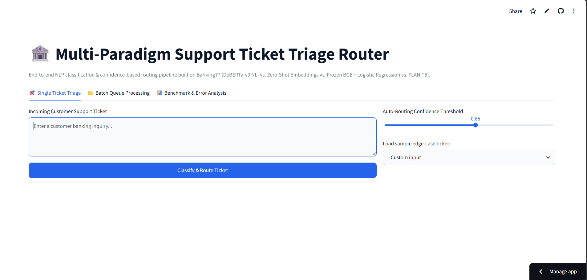
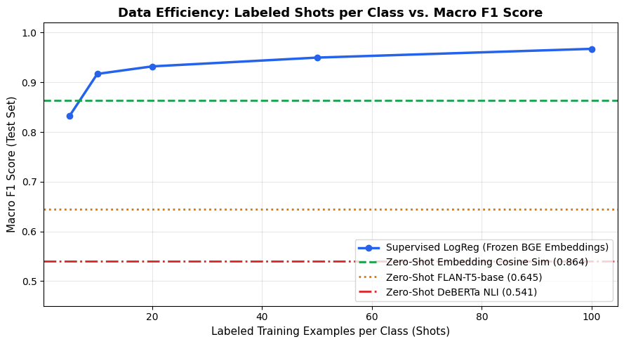

# 🏦 Multi-Paradigm Banking Support Ticket Triage Router

[](https://<your-streamlit-url>.streamlit.app)

An end-to-end NLP classification and confidence-based routing system built on the **Banking77** dataset, benchmarking four distinct text classification paradigms from *Hands-On Large Language Models* (Chapter 4).



## 🎯 Problem & Engineering Motivation
Customer support queues contain fine-grained, easily confused intents (e.g., *declined*, *pending*, vs. *reverted* card payments). Relying purely on zero-shot NLI or generative LLMs introduces high latency and label confusion, while blindly trusting supervised classifiers without confidence thresholds risks misrouting ambiguous edge cases.

This project benchmarks accuracy, throughput, and data efficiency across four paradigms and deploys a **confidence-gated triage router** that auto-routes high-confidence tickets in `<15ms` on CPU while escalating uncertain tickets for human or LLM fallback.

## 📊 4-Paradigm Model Benchmark
Evaluated on **400 balanced test tickets** across 10 confusable Banking77 intents:

| Paradigm | Model | Labeled Data | Macro F1 | Inference Time | Throughput |
| :--- | :--- | :---: | :---: | :---: | :---: |
| **1. Zero-Shot NLI** | `MoritzLaurer/DeBERTa-v3-base-mnli-fever-anli` | 0 shots | 0.5407 | 10.97 s | 36.5 tickets/s |
| **2. Zero-Shot Embedding Sim** | `BAAI/bge-small-en-v1.5` (Cosine Sim) | 0 shots (descriptions) | 0.8641 | 0.22 s | 1,860.4 tickets/s |
| **3. Frozen Embeddings + Linear** | `BAAI/bge-small-en-v1.5` + `LogisticRegression` | 1,497 tickets | **0.9699** | **0.26 s** | **1,555.4 tickets/s** |
| **4. Generative Text-to-Text** | `google/flan-t5-base` (FP16) | 0 shots (prompted) | 0.6451 | 9.64 s | 41.5 tickets/s |

### Data Efficiency & Crossover Analysis


* **Description Engineering Impact:** Replacing bare 3-word labels in NLI with single-sentence semantic descriptions in embedding space boosted zero-shot Macro F1 by **+32.3 percentage points** (`0.541` $\rightarrow$ `0.864`) while running **50× faster**.
* **Few-Shot Crossover:** Supervised `LogisticRegression` on frozen `bge-small` embeddings surpasses all zero-shot baselines with just **10 labeled examples per class** (`~0.918` Macro F1).

## 🚀 Run Locally

```bash
git clone [https://github.com/](https://github.com/)<your-github-username>/banking-ticket-triage-llm.git
cd banking-ticket-triage-llm
pip install -r requirements.txt
streamlit run app.py
